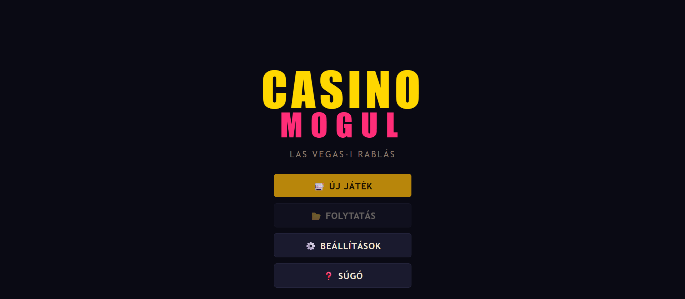
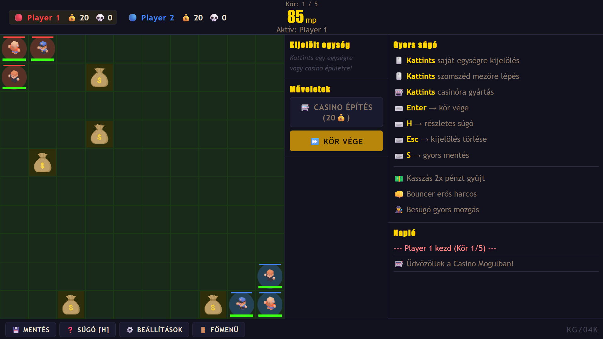
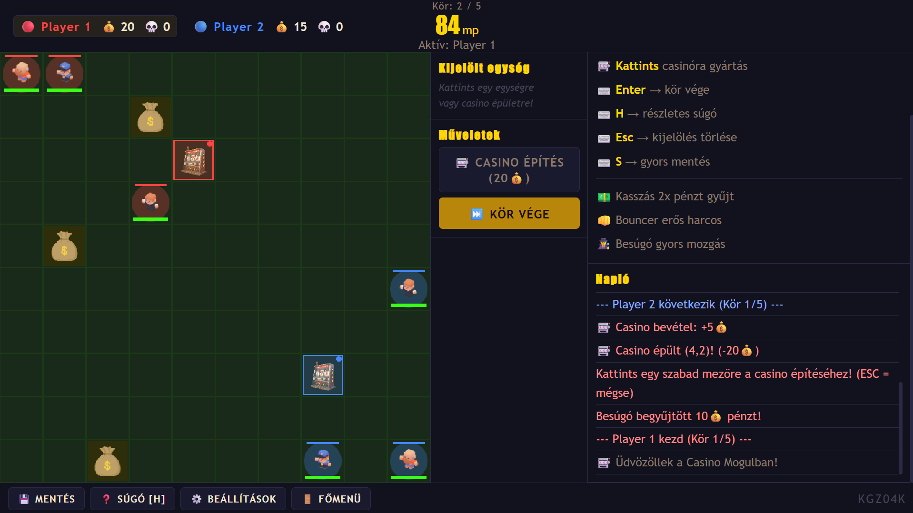

# 🎰 Casino Mogul

**Casino Mogul** egy böngészőben futó, körökre osztott stratégiai játék, ahol két játékos (Player 1 és Player 2) egy Las Vegas-i rablás témájú, 10×10-es rácspályán versenyez egymással. A cél 5 kör alatt a legtöbb pénzt összegyűjteni, akár erőforrás-gyűjtéssel, akár az ellenfél egységeinek legyőzésével.

## Tartalomjegyzék
- [Játékmenet](#játékmenet)
- [Egységek](#egységek)
- [Épületek és gazdaság](#épületek-és-gazdaság)
- [Vezérlés](#vezérlés)
- [Funkciók](#funkciók)
- [Technológiák](#technológiák)
- [Projekt szerkezete](#projekt-szerkezete)
- [Futtatás](#futtatás)
- [Képernyőképek](#képernyőképek)

## Játékmenet

A pálya egy 10×10-es rács, melyen véletlenszerűen 5 db pénzmező jelenik meg minden új játék indításakor. Mindkét játékos a saját sarkában indul 3-3 egységgel. A játékosok felváltva lépnek: egy körben egy egységet lehet mozgatni, pénzt gyűjteni, ellenféllel harcolni, vagy Casino épületet építeni/egységet gyártani. A kör "Kör vége" gombbal vagy az időzítő lejártával zárul le. 5 kör után a nagyobb pénzösszeggel rendelkező játékos nyer. Egyenlőség esetén a több ellenfél-ölés dönt.

## Egységek

| Egység | HP | Mozgás | Támadás | Gyártási ár | Különlegesség |
|---|---|---|---|---|---|
| 💵 Kasszás (collector) | 3 | 4 mező | 1 | 10💰 | 2x pénzt gyűjt |
| 👊 Bouncer | 5 | 3 mező | 3 | 20💰 | Erős támadás |
| 🕵️ Besúgó (scout) | 2 | 5 mező | 1 | 12💰 | Nagy mozgástávolság |

Ha egy egység olyan mezőre lép, ahol ellenfél áll, automatikus harc indul; ha pénz van a mezőn, azt az egység begyűjti.

## Épületek és gazdaság

20💰 birtokában bárhol felépíthető egy Casino a pályán, amely körönként 5💰 passzív bevételt termel, és saját egységek gyártására is alkalmas (Kasszás, Bouncer, Besúgó).

## Vezérlés

| Billentyű / interakció | Hatás |
|---|---|
| Kattintás saját egységre | Kijelölés (zöld mezők = elérhető lépések) |
| Kattintás elérhető mezőre | Mozgás / harc / gyűjtés |
| Kattintás saját Casinóra | Gyártási panel megnyitása |
| `Enter` | Kör vége |
| `H` | Súgó megnyitása/bezárása |
| `Esc` | Kijelölés törlése / építési mód megszakítása |
| `S` | Gyorsmentés |

## Funkciók

- **Statikus grafikus elemek**: canvas alapú pályarajz, karakter- és épület-sprite-ok (`assets/images`).
- **Dinamikus grafikus elemek**: HUD (pénz/kill számláló élőben frissül), egység- és épületpanelek, kijelölt egység elérhető mezőinek kirajzolása.
- **Időzítés**: körönkénti visszaszámláló időzítő (`setInterval`), amely a beállított idő (30/60/90 mp) lejártakor automatikusan lezárja a kört.
- **Animáció**: CSS `@keyframes` alapú időzítő-pulzálás (`timer-pulse`) és canvas-villanás (`canvas-flash`) találat/esemény esetén, valamint sávos átmenetek (`transition`) a HP/erőforrás-csíkokon.
- **Hangeffektek**: esemény-vezérelt hangok (gyűjtés, találat, körváltás, győzelem) és hurkolt háttérzene, ki/be kapcsolható beállításban (`js/audio.js`).
- **Felhasználói interakció**: egérkattintás egységmozgatáshoz/gyártáshoz, billentyűzetes gyorsbillentyűk (`Enter`, `H`, `Esc`, `S`).
- **Mentés/betöltés**: teljes játékállapot mentése és visszatöltése `localStorage`-ban (`js/save.js`), főmenüből "Folytatás" opcióval.
- **Beállítások**: kör időlimit (30/60/90 mp), nappali/éjszakai téma, hang be/ki — mind menthető konfigurációként.
- **Súgó**: beépített súgó modal a célról, egységtáblázattal, billentyűkiosztással és a kör menetének lépésről lépésre leírásával; emellett állandó "Gyors súgó" panel a játék közben.

## Technológiák

- **HTML5 / CSS3** — szerkezet, reszponzív elrendezés, animációk
- **Vanilla JavaScript (modulminta: IIFE)** — `map.js`, `units.js`, `game.js`, `ui.js`, `audio.js`, `save.js`, `main.js`
- **jQuery 3.7.1** — DOM-manipuláció és eseménykezelés
- **Canvas API** — a pálya és az egységek rajzolása
- **Web Audio (`HTMLAudioElement`)** — hangeffektek és háttérzene
- **localStorage** — állásmentés és konfiguráció perzisztálása

## Projekt szerkezete

```
Casino/
├── index.html          # Fő HTML váz, képernyők és modalok
├── css/
│   └── style.css        # Elrendezés, témák, animációk
├── js/
│   ├── main.js           # Belépési pont, eseménykezelők bekötése
│   ├── game.js            # Játékmenet-logika, kör és időzítéskezelés
│   ├── map.js              # Pályagenerálás, canvas rajzolás
│   ├── units.js             # Egységek definíciója, mozgás, harc
│   ├── ui.js                 # Panel- és HUD-frissítések, napló
│   ├── audio.js                # Hangeffektek és háttérzene kezelése
│   └── save.js                  # localStorage mentés/betöltés
└── assets/
    ├── images/                     # Karakter- és épület sprite-ok
    └── sounds/                      # Hangeffektek, háttérzene
```

## Futtatás

A projekt statikus front-end alkalmazás, szerver nélkül futtatható:

1. Töltsd le / klónozd a repót.
2. Nyisd meg az `index.html` fájlt böngészőben (ajánlott élő szerverrel, pl. VS Code Live Server, a jQuery CDN és a hangfájlok zökkenőmentes betöltése miatt).

## Képernyőképek

<!-- Ide kerülnek a menü és a játék screenshotjai -->




---

**Készítette:** Németh Gergő  Neptun kód: **KGZ04K**
